<div align="center">


# Foxlume Query

**A fast, native macOS database client for PostgreSQL and MySQL.**<br>
Browse tables, write SQL with smart autocomplete, edit data safely and understand your queries, in an app built only with Swift and AppKit.

[](https://github.com/dannymaster1995-developer/foxlume-query/actions/workflows/ci.yml)
[](LICENSE)


[Features](#features) · [Databases](#supported-databases) · [Install](#install) · [Shortcuts](#keyboard-shortcuts) · [FAQ](#faq) · [Contributing](#contributing)

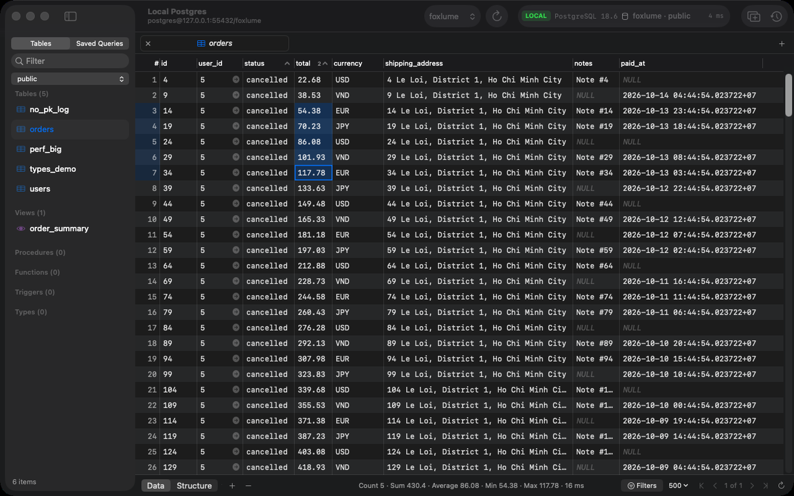

</div>

## Why Foxlume Query?

- **Native and light.** A real Mac app (AppKit, no Electron, no Java). It starts fast and stays responsive on tables with millions of rows.
- **No drivers to install.** The PostgreSQL, MySQL, MongoDB and Redis protocols are built into the app in Swift.
- **Safe by default.** Edits are staged until you save, saves run in a transaction, and each connection has a Safe Mode, from "ask before writing" to Touch ID or fully read-only.
- **Free and open source** under the AGPL-3.0. Inspired by [TablePro](https://github.com/TableProApp/TablePro), and an open alternative to TablePlus, Sequel Ace and DBeaver for Mac users.

> [!NOTE]
> Foxlume Query is in **early alpha (0.1.0)**. [Download the latest release](https://github.com/dannymaster1995-developer/foxlume-query/releases/latest) or [build it from source](#build-from-source) in a few minutes. Bug reports and ideas are very welcome.

## Features

### Write SQL faster

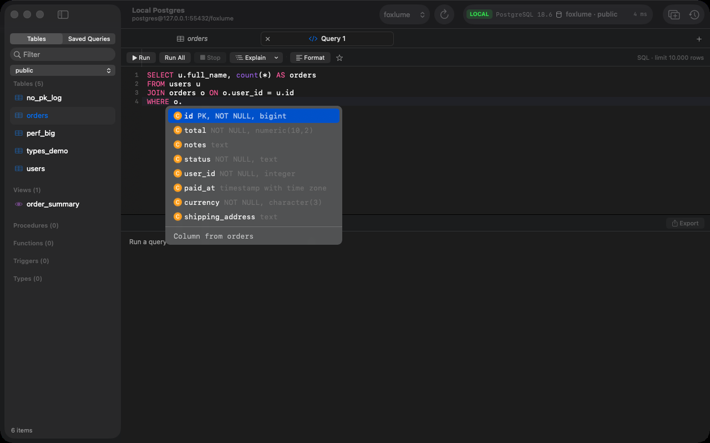

- **Context-aware autocomplete.** It knows the clause you are in, the tables and aliases in scope, CTEs and subqueries. It suggests columns with their types and keys, functions with signatures, and keywords for your database's dialect.
- **Saved queries.** Save a query with ⌘D, organise saved queries in folders, and give one a keyword to insert it while you type.
- **Run what you need.** Run the statement under the cursor (⌘↩), everything (⇧⌘↩) or without the row limit (⌥⌘↩), or run it and move on to the next statement (⌃⌘↩) to step through a script. Format SQL (⇧⌘L) and keep a searchable history.
- **See which statement runs.** The statement under the cursor is shaded in colors taken from your editor theme, built-in or imported. Word wrap can be turned off (View › Word Wrap, ⌥Z) to scroll long lines sideways; both are in Settings › SQL Editor.
- **Open Quickly (⇧⌘O).** One fuzzy search across tables, views, functions, databases, saved queries and history.

### AI suggestions (off by default)

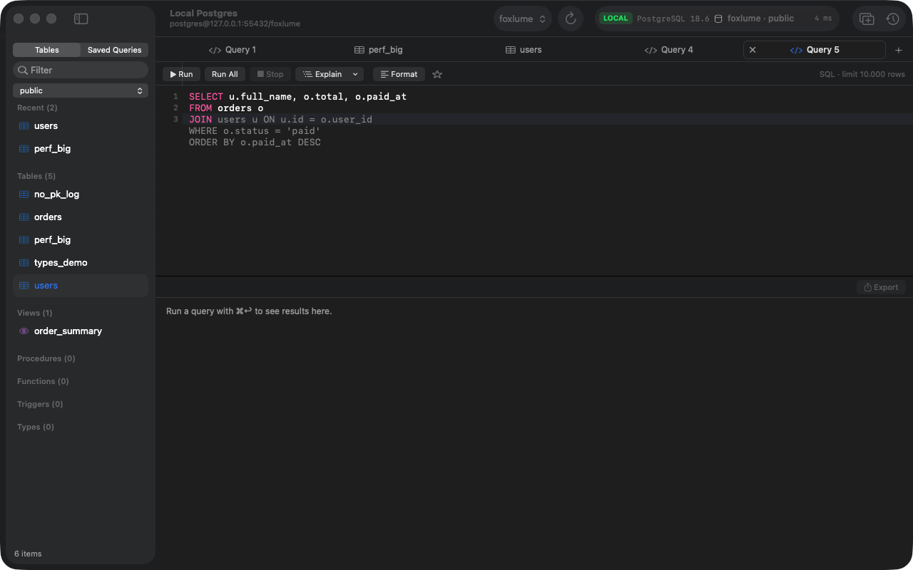

- **Inline suggestions in the SQL editor.** Pause while typing and the next part of your query appears in grey after the cursor. Tab accepts it, ⌥→ takes one word, Esc dismisses it, and Query › Suggest with AI (⌥\\) asks at once. Works in the SQL editor of every SQL engine; MongoDB and Redis editors are not supported yet.
- **Bring your own provider.** Any OpenAI-compatible API (OpenAI, OpenRouter, Gemini, or a local model in Ollama or LM Studio) or Anthropic's Claude, set up in Settings › AI with Fetch Models and Test. API keys are kept in the macOS Keychain.
- **GitHub Copilot.** Turn on Settings › AI › GitHub Copilot and sign in with GitHub (a device code, copied for you, entered on github.com); you need a GitHub Copilot subscription, and Copilot Free works. Foxlume Query downloads GitHub's Copilot language server from npm the first time, checks its checksums, and runs it on your Mac; your GitHub sign-in stays with the language server. Unlike the other providers, Copilot gets the whole query tab. Account and billing notices from GitHub show in a small panel.
- **Private by default.** AI is off until you turn it on and add a provider. Chat providers get only the text around the cursor, GitHub Copilot the whole query tab; with them go the database engine's name and, unless you turn it off, table and column names, types and keys: never row values, query results or connection details. Each connection has an AI setting: Allow, Ask or Never, for Copilot too. New connections ask the first time, and nothing is sent before you answer; Production connections default to Never. See [What does AI send?](#faq)

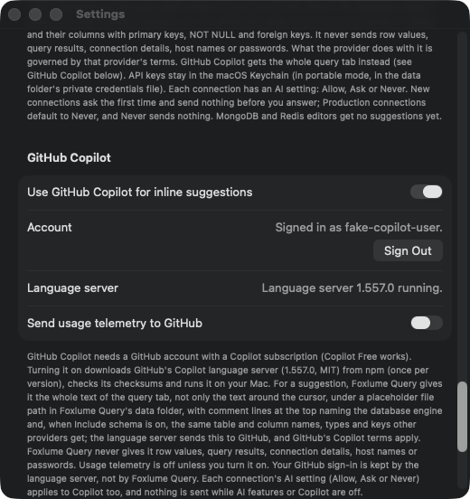

### Browse and edit data

- **A fast grid** with server-side paging, sorting on several columns (Shift-click) and filters: between, regex, IN, match case, and saved presets.
- **Spreadsheet-style editing:** select ranges, copy as TSV, paste from Excel or CSV, fill a column, set cells to NULL, an empty string, DEFAULT or the current timestamp (Set Value in the cell menu), see sum and average of the selection. Copy rows as CSV, JSON, Markdown, SQL INSERT or UPDATE statements, or a column's values as an `IN (…)` list. Every change waits for ⌘S, and Preview SQL (⇧⌘P) shows exactly what will run.
- **Editors that know the column type:** booleans are check boxes (Space or a click toggles them), dates and times open a date picker with Now and NULL, enum columns (PostgreSQL enum types, MySQL and MariaDB `ENUM`) list their values, and foreign key columns offer a searchable list of the referenced rows. Typing a value by hand always works too.
- **Arrange columns:** drag to reorder, hide columns or pick them from a checklist, size them to fit (or double-click a divider), and jump to a column by typing its name (⌃⌘J). Each table remembers its column order, widths and hidden columns.
- **Look inside values:** View Value (⌥↩) shows JSON as a tree you can filter, with Copy Value and Copy Path (`$.items[2].name`); previews images and PDFs stored in binary columns (PNG, JPEG, GIF, WebP, HEIC, TIFF, BMP) with Save As for the original bytes; and dumps any binary value as offset, hex and ASCII, fast even for blobs of many megabytes.
- **Favourites and Recent** at the top of the sidebar: star a table, view, collection, function, procedure, trigger or type (the star at the end of its row, its context menu or ⌥⌘B) and it stays one click away for that connection; Recent lists the last ten tables and views you opened. Rows from another database or schema are labelled and switch the database when opened, favourites can be dragged into order, and they follow renamed tables, schemas and databases.
- **Follow foreign keys** with one click, inspect a row in the Row Inspector (⌥⌘I), and find text in results or across the whole table.

### Understand your queries

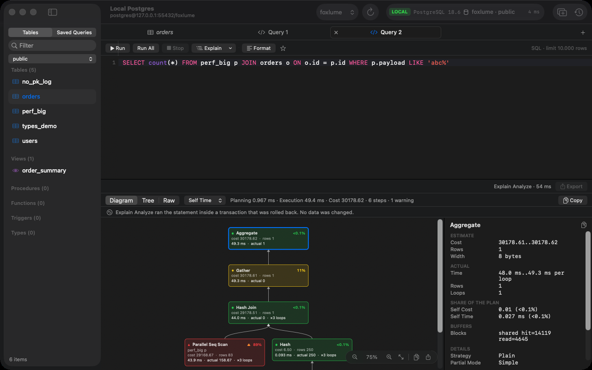

- **Explain (⌥⌘E) and Explain Analyze (⌃⌘E)** draw the query plan as a diagram or a tree. Slow steps are highlighted, and warnings such as large scans or wrong row estimates are shown with each step.
- Explain Analyze on PostgreSQL runs inside a transaction that is rolled back, so even an `UPDATE` changes nothing.

### Design your schema

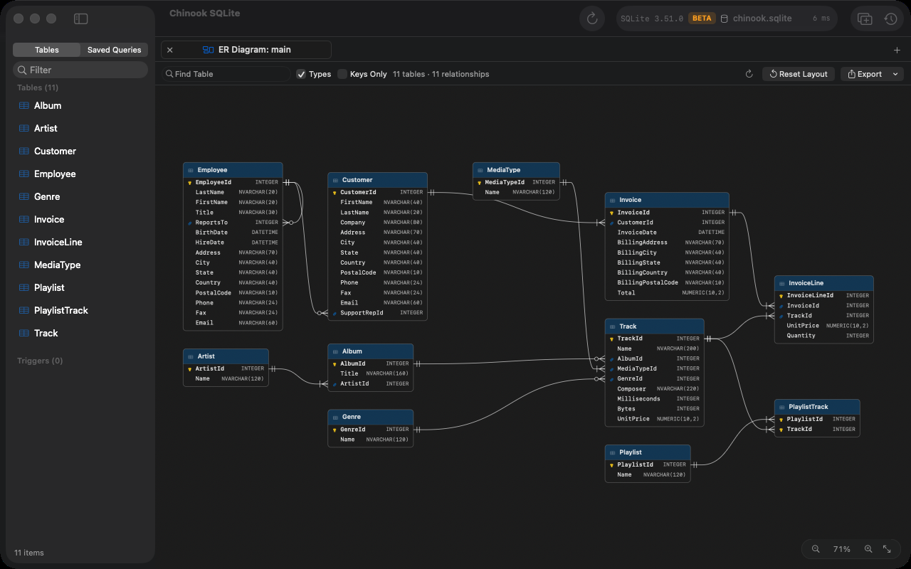

- **ER diagrams** of a whole schema, with crow's-foot relationships, drag-to-arrange layouts that are remembered, and PNG or PDF export.
- **A structure editor** for PostgreSQL and MySQL: add or change columns, indexes, foreign keys and comments, drag columns into a new order, review the generated `ALTER` statements, then save. MySQL moves columns in place; PostgreSQL rebuilds the table in one transaction when nothing depends on it. **New Table** builds a `CREATE TABLE` with a live preview.
- **Functions, procedures, triggers and types** in the sidebar, with their source and "Edit in Query Tab".
- **Rename and copy** on PostgreSQL: Rename Schema, Rename Database and Copy Database. Open tables, column layouts, ER layouts and filter presets follow the new name, and if someone else is connected to the database you are renaming or copying, Foxlume Query tells you who instead of failing halfway.
- **Maintenance** from the sidebar (Shift-click to select several tables) or Database › Maintenance: Vacuum, Vacuum Analyze, Analyze, Vacuum Full and Reindex on PostgreSQL; Optimize, Analyze, Check and (MyISAM and Aria) Repair Table on MySQL and MariaDB; Analyze, Integrity Check and Vacuum on SQLite; Analyze and Checkpoint on DuckDB. Commands run one table at a time on a separate connection, so the rest of the app keeps working, and the server's answer, status and time of each table show as they finish, with Cancel.
- **Server Activity** (Database › Server Activity, ⌥⌘A) on PostgreSQL, MySQL and MariaDB: every session on the server with its user, database, client, state and running statement, refreshed every 2 seconds, longest running first, with a filter, a Hide idle switch and Pause. Cancel a session's query or end the session (`pg_cancel_backend` / `pg_terminate_backend`, `KILL QUERY` / `KILL CONNECTION`) after a confirmation, never on Read-Only connections. Foxlume Query's own sessions are marked. **Slow Queries** lists the top statements by total or mean time from `pg_stat_statements` or `performance_schema`, when the server collects them, with Copy and Open in Query Tab.
- **Views** for PostgreSQL, MySQL, MariaDB, SQLite and DuckDB: **New View** opens a `CREATE VIEW` template, **Edit View** opens the current definition ready to replace, and **Save View** runs it and selects the view in the sidebar. PostgreSQL materialized views can be edited and refreshed too.

### Import and export

- **Export Tables** to CSV, JSON, NDJSON, Excel (XLSX: a sheet per table, typed numbers, booleans and dates, a bold frozen header) or a SQL dump (structure, data or both, optionally gzipped), streamed from a consistent snapshot. Export Results (⇧⌘E) can write XLSX too.
- **Import CSV, JSON, NDJSON or Excel (XLSX)** into a table with column mapping and a choice of what to do with bad rows: encoding and delimiter detection for CSV, nested JSON values into JSON or text columns, a sheet picker and Excel dates for workbooks.
- **Run SQL files** (`.sql`, `.sql.gz`) of any size, including mysqldump scripts with `DELIMITER` blocks.
- **Backup and Restore** for PostgreSQL, MySQL and MariaDB with the client tools on your Mac (pg_dump and pg_restore, mysqldump or mariadb-dump): a whole database, some schemas or some tables, in pg_dump's custom, plain, directory or tar format or as a (gzipped) SQL script. Restore archives with pg_restore into this or another database, and scripts with Run SQL File, psql or mysql. Runs through the connection's SSH tunnel and TLS settings, keeps the password off the command line, streams the tool's progress with Cancel, and shows the exact command it ran.

### Connect securely

- **TLS 1.3**, with Verify CA / Verify Identity modes, a custom CA and client certificates (PEM or PKCS#12).
- **SSH tunnels**, connection URLs (`postgres://`, `mysql://`…) and passwords kept in the macOS Keychain.
- **Safe Mode** per connection: Silent, Alert, Safe Mode with Touch ID, or Read-Only. Production connections are clearly labelled.
- **Environment-tinted toolbar**: a Production window's toolbar turns red and a Staging one orange (Development and Local on request in Settings › Appearance), and so does its Server Activity window, so a Production window is hard to mistake for another.
- **Query timeout and startup commands** per connection: stop queries that run too long, and run SQL such as `SET search_path` or `SET time_zone` on every new session, reconnects included.

<details>
<summary><b>More screenshots</b></summary>
<br>

| Open Quickly | Structure editor |
|---|---|
| 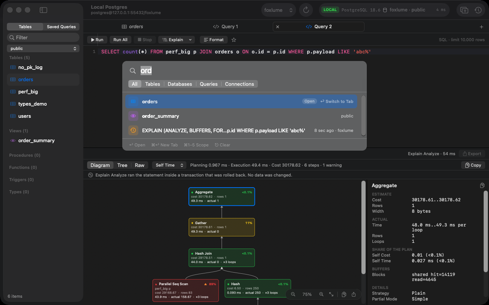 | 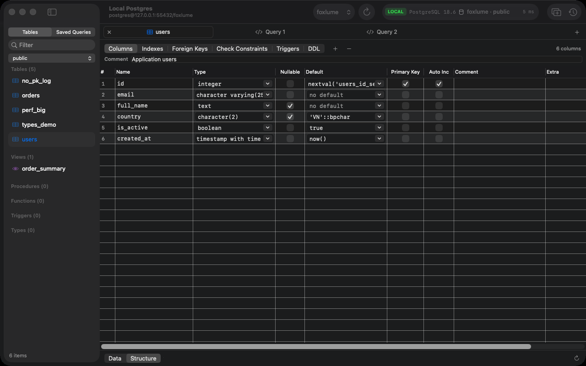 |

| ER diagram (light) | Value viewer |
|---|---|
| 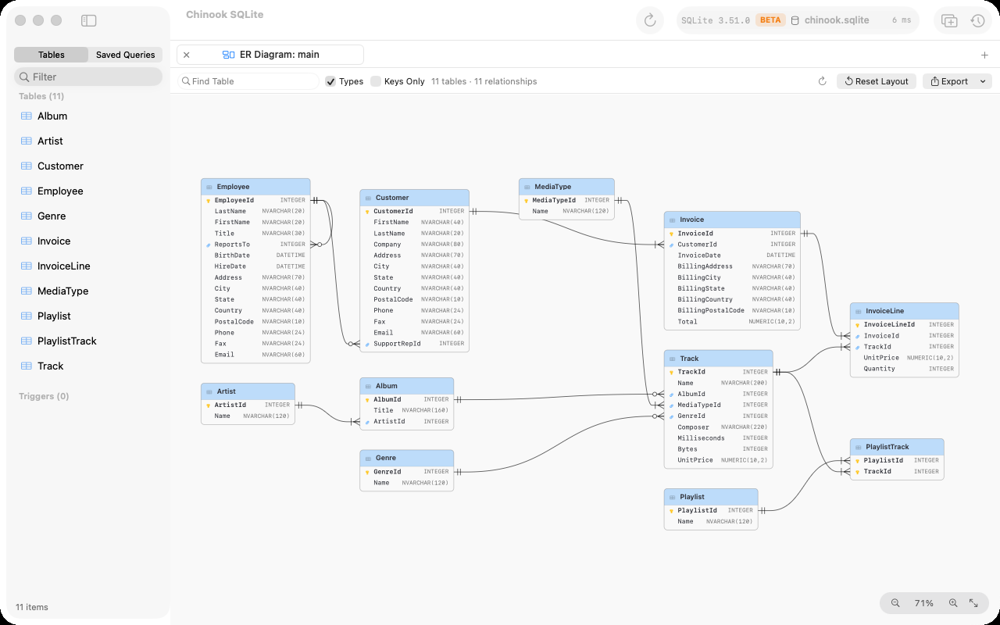 | 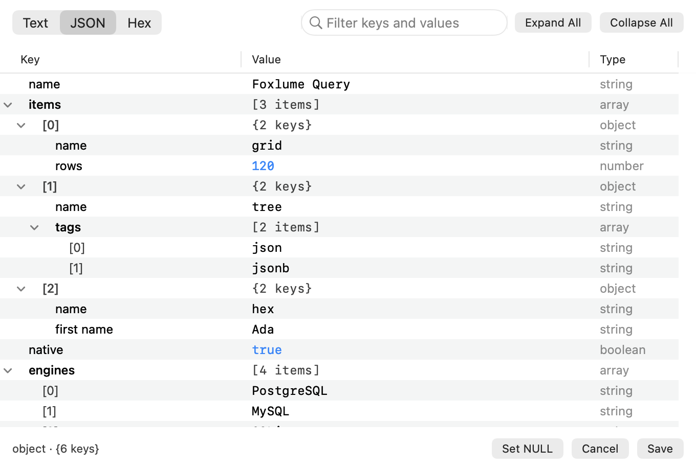 |

| Statement under the cursor | Word wrap off |
|---|---|
| 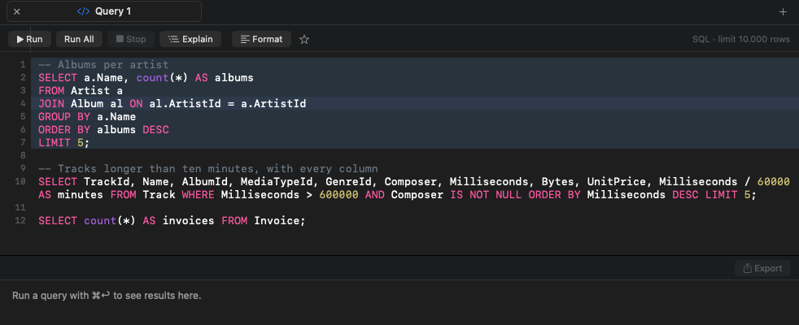 | 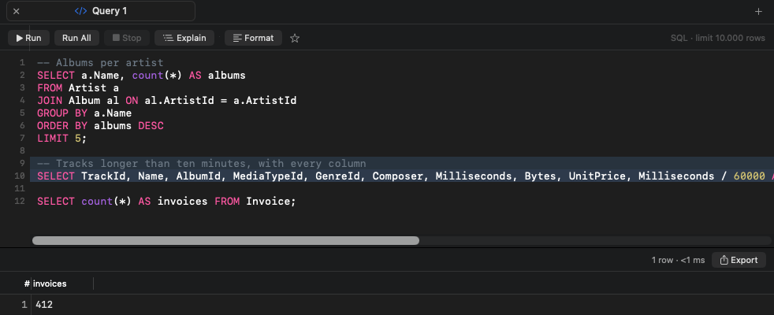 |

| Maintenance | Server Activity |
|---|---|
| 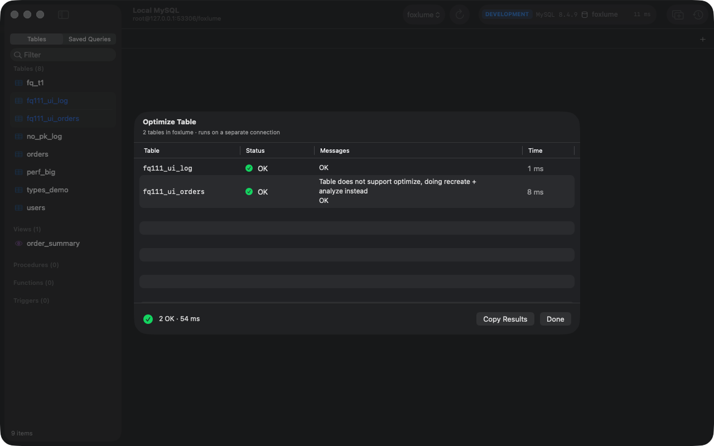 | 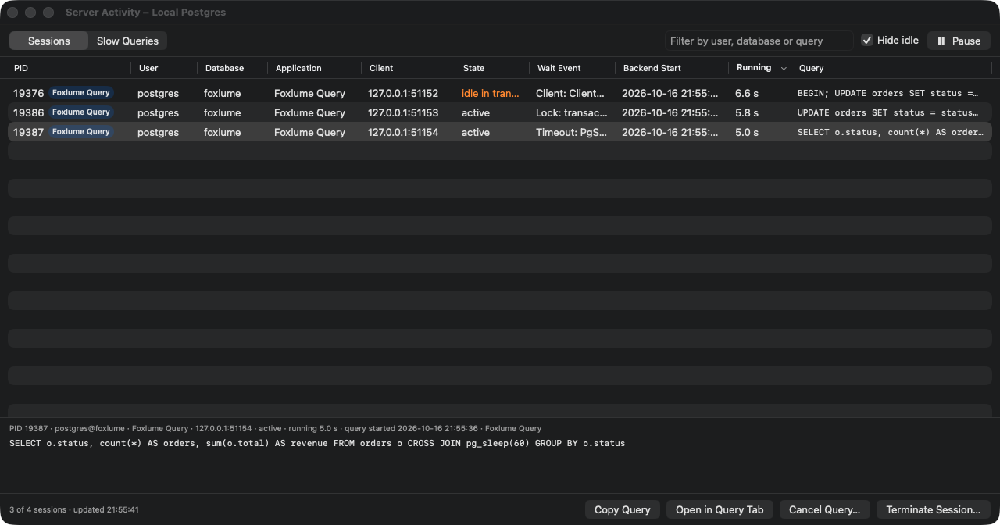 |

| Import from Excel | Export to Excel |
|---|---|
| 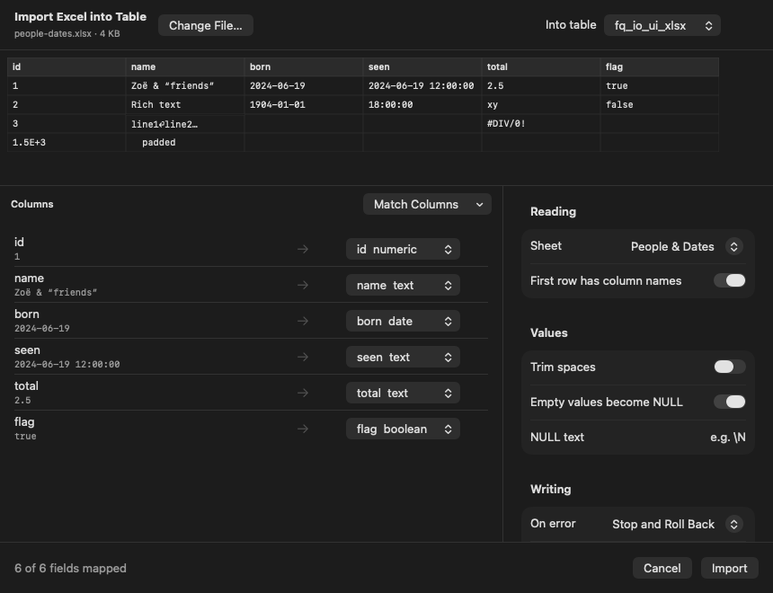 | 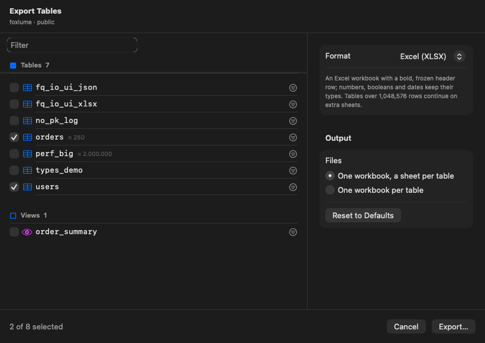 |

| Backup | Restore |
|---|---|
| 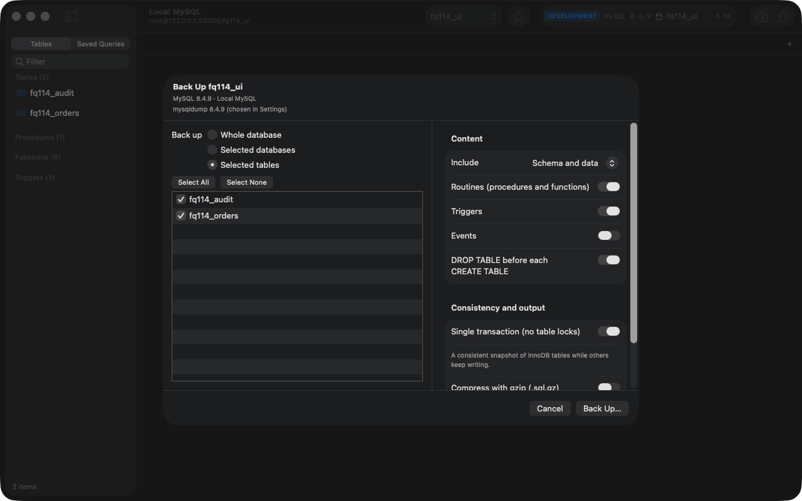 | 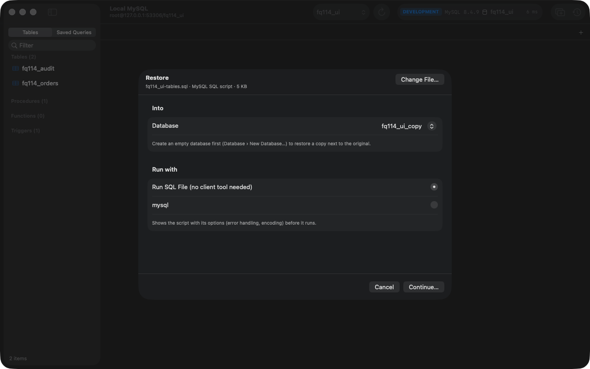 |

| Production toolbar tint | Production toolbar tint (dark) |
|---|---|
| 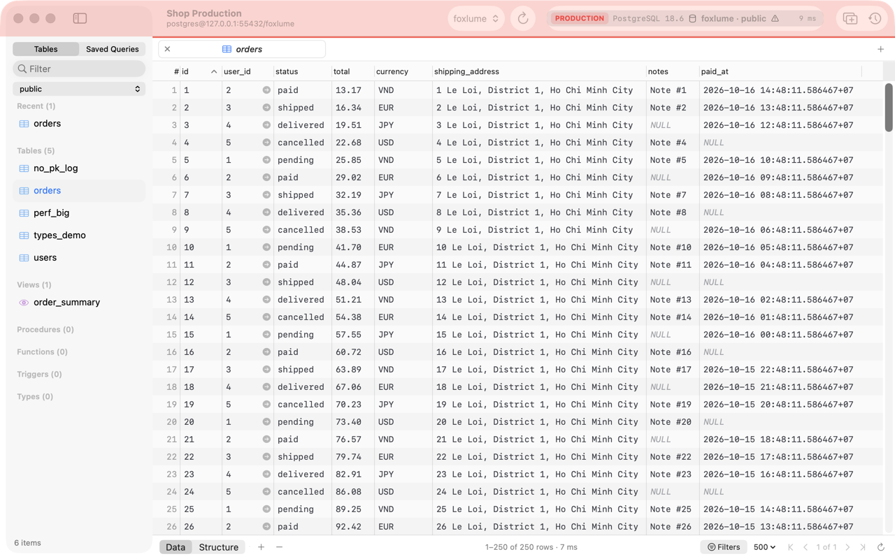 | 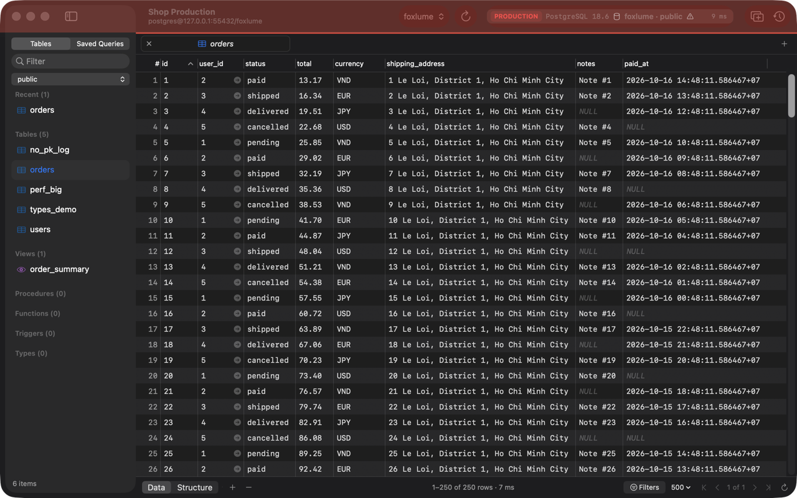 |

</details>

## Supported databases

| Database | Status | Notes |
|---|---|---|
| **PostgreSQL** | ✅ Supported | Tested with 18; SCRAM-SHA-256, MD5, TLS 1.3 |
| **MySQL** | ✅ Supported | Tested with 8.4; caching_sha2_password, TLS 1.3 |
| MariaDB | 🧪 Beta | Uses the MySQL driver |
| SQLite | 🧪 Beta | Uses the system SQLite |
| DuckDB | 🧪 Beta | Opens `.duckdb`, Parquet, CSV and JSON files |
| MongoDB | 🧪 Beta | `mongodb://` and `mongodb+srv://`, MQL shell |
| Redis | 🧪 Beta | ACL, TLS, Sentinel and Cluster; keys as a tree |

PostgreSQL and MySQL are the focus of the first releases. Beta engines work, but they have had less testing and some features are missing.

## Install

### Download

Requires macOS 13 or later on Apple silicon.

1. Download `Foxlume-Query-<version>-arm64.zip` from the [latest release](https://github.com/dannymaster1995-developer/foxlume-query/releases/latest).
2. Unzip it and move **Foxlume Query.app** to Applications.
3. The app is signed ad hoc (no Apple Developer ID), so macOS blocks the first launch of a downloaded copy. Clear the quarantine flag once:

```bash
xattr -dr com.apple.quarantine "/Applications/Foxlume Query.app"
```

Each release lists its changes and a SHA-256 checksum of the zip. All changes are in [CHANGELOG.md](CHANGELOG.md) and the plan is in [ROADMAP.md](ROADMAP.md).

### Build from source

**Requirements:** macOS 13 or later on Apple silicon, and Swift 6 (Xcode, or just the Command Line Tools: `xcode-select --install`).

```bash
git clone https://github.com/dannymaster1995-developer/foxlume-query.git
cd foxlume-query
scripts/build-app.sh            # builds "build/Foxlume Query.app" (downloads DuckDB on first run)
open "build/Foxlume Query.app"
```

The app is signed ad hoc. After a rebuild, macOS may ask again for Keychain access; choose **Always Allow**.

Developing on Foxlume Query? See [docs/DEVELOPMENT.md](docs/DEVELOPMENT.md) for the test suite, local test servers and project layout.

## Keyboard shortcuts

The most used ones:

| Keys | Action |
|---|---|
| ⌘↩ / ⇧⌘↩ | Run statement / run all |
| ⌃⌘↩ | Run statement and move to the next one |
| ⇧⌘O | Open Quickly |
| ⌃Space | Show completions |
| ⌥⌘E / ⌃⌘E | Explain / Explain Analyze |
| ⌘S / ⇧⌘P | Save changes / preview their SQL |
| ⇧⌘L | Format SQL |
| ⌘D | Save the query |

<details>
<summary><b>All shortcuts</b></summary>
<br>

| Keys | Action |
|---|---|
| ⌘N / ⇧⌘K | New connection / open connection URL |
| ⌘T / ⌘W / ⇧⌘T | New query tab / close tab / reopen closed tab |
| ⌘1 … ⌘9, ⌘{ ⌘} | Switch tabs |
| ⌘↩ / ⇧⌘↩ / ⌥⌘↩ | Run statement / run all / run without limit |
| ⌃⌘↩ | Run statement and move to the next one |
| ⌘. | Cancel query |
| ⇧⌘L | Format SQL |
| ⌥⌘E / ⌃⌘E | Explain / Explain Analyze |
| ⌃Space | Show completions |
| ⌥\ | Suggest with AI (when AI is on) |
| Tab / ⌥→ / Esc | Accept the grey AI suggestion / take its next word / dismiss it |
| ⌘D | Add the query (or the selection) to Saved Queries |
| ⇧⌘O | Open Quickly (⌘1 … ⌘5 pick its scope, ⌘↩ opens in a new tab) |
| ⌘S | Save (staged truncates and drops, grid edits, or the SQL file) |
| ⇧⌘P | Preview SQL |
| ⇧⌘N / ⇧⌘D / ⌘⌫ | Add / duplicate / delete rows |
| ⌥↩ | Edit cell value |
| ⇧⌘F | Filter rows |
| ⌘F / ⌘G / ⇧⌘G | Find in results / next / previous match |
| ⌥⌘I | Row Inspector |
| ⌃⌘J | Jump to column |
| ⌘[ / ⌘] | Previous / next page |
| ⌥⌘↑ / ⌥⌘↓ | First / last page; in the structure editor's column list, move the selected columns up / down |
| ⌘R / ⇧⌘R | Reload data / reload table list |
| ⌘K | Switch database |
| ⌥⌘B | Add to or remove from Favourites |
| ⌥⌘A | Server Activity (sessions and slow queries) |
| ⌥⌘1 / ⌥⌘2 | Data / Structure |
| ⌘Y | Query history |
| ⌃⌥⌘F | Focus the sidebar filter |
| ⌘0 | Toggle sidebar |
| ⌘/ | Toggle comment |
| ⌥Z | Word wrap on or off |
| ⌥⌘C / ⌥⌘J | Copy with headers / copy as JSON |
| ⌘V | Paste cells or rows into the grid |
| Shift-click a header | Add a column to the sort |
| ⇧ arrows / ⇧⌘ arrows | Extend the cell selection by one cell / to the edge |
| ⇧Space / Esc | Widen the cell selection to whole rows / end it |
| Space | Toggle the selected boolean cells |
| ⌘= / ⌘- / ⌘C | Zoom in / zoom out / copy as image, in a plan or ER diagram |
| ⇧⌘E / ⌥⇧⌘E | Export results / export tables |
| ⇧⌘I | Import CSV, JSON or XLSX into a table |

</details>

## FAQ

<details>
<summary><b>Is there a download?</b></summary>

Yes. Every release on the [releases page](https://github.com/dannymaster1995-developer/foxlume-query/releases/latest) has a zip of the app for Apple silicon; see [Install](#download) for the one-time quarantine step. You can also [build it from source](#build-from-source) in a few minutes, with no Apple developer account.
</details>

<details>
<summary><b>Where are my connections and passwords stored?</b></summary>

Connections, settings, history and saved queries are in `~/Library/Application Support/Foxlume Query/`, and so is the GitHub Copilot language server once you turn Copilot on. Passwords, TLS key passphrases and AI provider API keys are in the macOS Keychain; your GitHub sign-in for Copilot is kept by GitHub's language server, not by Foxlume Query. For a portable setup, set `FOXLUME_DATA_DIR=/some/folder` (or use `scripts/run-portable.sh`), and everything, passwords included, is kept in that folder.
</details>

<details>
<summary><b>What does AI send?</b></summary>

Nothing until you turn on AI features in Settings › AI and add a provider. Then, for a suggestion, Foxlume Query sends the active provider only: up to 2,000 characters of the query editor before the cursor and 500 after it, the database engine's name and, when Include schema is on (the default), the names and types of up to 20 tables (a setting) and their columns, with primary keys, NOT NULL and foreign keys. It never sends row values, query results, connection details, host names or passwords. Requests go straight from your Mac to the provider you set up; with a local server such as Ollama or LM Studio nothing leaves your Mac. What the provider does with it is governed by that provider's terms. API keys are kept in the macOS Keychain (in portable mode, in the data folder's private credentials file). Each connection has an AI setting: Allow, Ask or Never. New connections ask the first time a suggestion would be requested (Allow, Not Now or Never), and nothing is sent before you answer; Production connections default to Never, and Never sends nothing. MongoDB and Redis editors send nothing.

GitHub Copilot works differently. It needs a GitHub account with a Copilot subscription (Copilot Free works). Turning it on in Settings › AI › GitHub Copilot downloads GitHub's Copilot language server (`@github/copilot-language-server`, MIT) from npm once per version; Foxlume Query checks it against the checksums of the version it was released with and runs it on your Mac. For a suggestion, Foxlume Query gives the language server the whole text of the query tab, not only the text around the cursor, under a neutral placeholder file name, with comment lines at the top naming the database engine and, when Include schema is on, the same table and column names, types and keys as above. The language server sends this to GitHub, and GitHub's Copilot terms apply. Foxlume Query never gives it row values, query results, connection details, host names or passwords. Copilot's usage telemetry is off unless you turn it on in the same section. Your GitHub sign-in is kept by the language server, not by Foxlume Query. The language server also keeps its own files, as it does in other editors: `~/.config/github-copilot`, `~/.copilot`, `~/.cache/pkg` and `~/Library/Application Support/Microsoft`. The connection's AI setting applies to Copilot exactly as to the other providers: no query text reaches the language server before you allow a connection, and when a connection is set to Never its query tabs are closed at the language server.
</details>

<details>
<summary><b>Can I use it with my production database?</b></summary>

Yes, carefully: it is alpha software. Give the connection a Production label and a Safe Mode (Alert, Safe Mode with Touch ID, or Read-Only), so every write asks first or is refused.
</details>

<details>
<summary><b>Backup needs pg_dump / mysqldump</b></summary>

Backup and Restore run the PostgreSQL and MySQL client tools installed on your Mac; Foxlume Query does not include them. Install them with Homebrew, `brew install libpq` (pg_dump, pg_restore and psql) and `brew install mysql-client` (mysqldump and mysql), or `brew install mariadb` for MariaDB servers, or install [Postgres.app](https://postgresapp.com). Foxlume Query finds them in your shell's PATH, Homebrew's folders (keg-only libpq and mysql-client included) and Postgres.app; Settings › Backup Tools shows what it found and lets you choose another copy. pg_dump cannot back up a server newer than itself, so the newest copy found is used and you are warned when it is still too old. Plain `.sql` / `.sql.gz` backups restore without any tool, through Run SQL File.
</details>

<details>
<summary><b>What is not there yet?</b></summary>

SQL Server and other engines, plan comparison, MongoDB X.509 authentication and certificate revocation checks. See the [CHANGELOG](CHANGELOG.md) for what is new.
</details>

## Contributing

Bug reports, ideas and pull requests are welcome. Start with [CONTRIBUTING.md](CONTRIBUTING.md) and [docs/DEVELOPMENT.md](docs/DEVELOPMENT.md). To report a security issue, see [SECURITY.md](SECURITY.md).

## License

Foxlume Query is free software under the [GNU Affero General Public License v3.0 or later](LICENSE). It includes DuckDB (MIT License); see [THIRD_PARTY_NOTICES.md](THIRD_PARTY_NOTICES.md).

Its features and interface are inspired by [TablePro](https://github.com/TableProApp/TablePro). Foxlume Query is an independent project and is not affiliated with TablePro.
